<div align="center">


# FocusFlow

**A calm, Apple Music-style player for long work sessions on macOS.**
Crossfade, spatial headphone sound, nature themes, and a native engine that barely sips power.


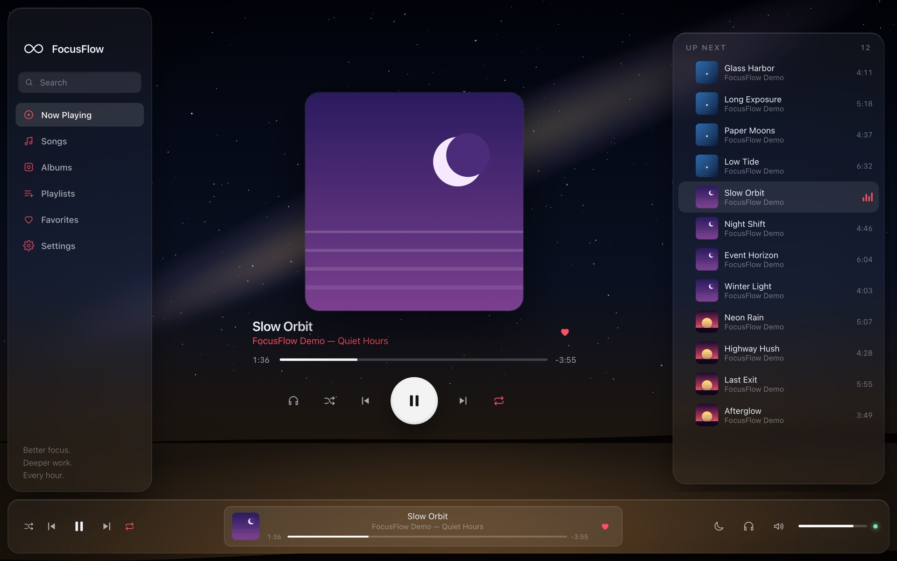

<sub>Screenshots use invented demo songs and generated covers. FocusFlow ships with no music.</sub>

</div>

---

## Contents

[Highlights](#highlights) · [Screenshots](#screenshots) · [Install](#install) · [Add your music](#add-your-music) · [Features](#features) · [Keyboard shortcuts](#keyboard-shortcuts) · [Efficiency](#efficiency) · [How it works](#how-it-works) · [Testing](#testing-and-honest-status) · [Limitations](#known-limitations) · [Troubleshooting](#troubleshooting)

## Highlights

- **A real native audio engine.** Rust (`symphonia` + `cpal`) decodes MP3, M4A/AAC, FLAC, WAV and OGG, mixes with equal-power **crossfade (0–12 s)**, and handles track changes itself, so playback never depends on a webview timer.
- **Spatial sound for headphones.** Wide, Room and Orbit modes with an intensity slider, tested to make a clearly audible difference.
- **Earbuds and media keys just work.** FocusFlow registers as the macOS *Now Playing* app, so AirPods/Bluetooth buttons, keyboard media keys and Control Center control it instead of a paused browser tab.
- **Import from a link.** Paste a video or album link and FocusFlow downloads the audio and **splits it into separate tracks**, even when the video has no chapters.
- **Albums, playlists, favorites, queue**, all editable: rename, add, remove, reorder, drag to reorder.
- **Six static nature themes**, sleep timer with a gentle fade, optional keep-awake.
- **Light on power.** Nothing animates, and the engine sleeps between bursts of work. See [Efficiency](#efficiency).
- **Offline and private.** No account, no backend, no subscription, no AI API. Your library lives in a folder you choose.

## Screenshots

| | |
|:--:|:--:|
| 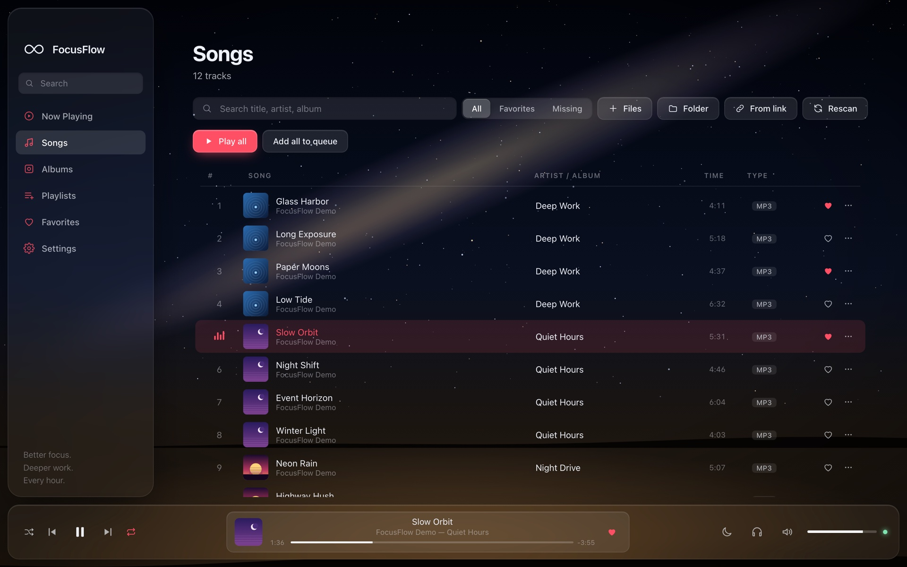<br/><sub><b>Songs</b>: search, filter, click a thumbnail to play</sub> | 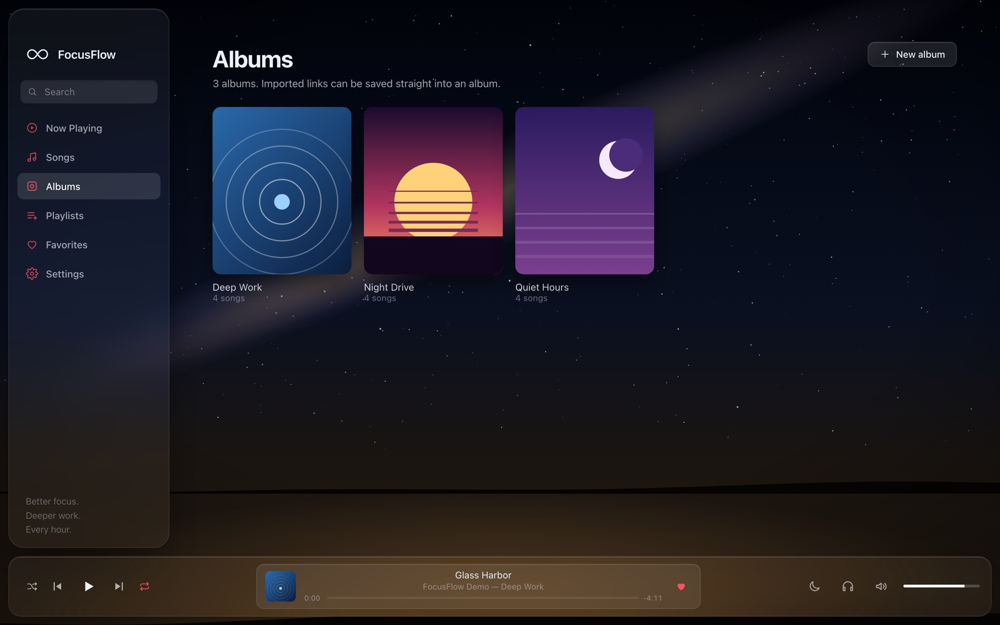<br/><sub><b>Albums</b>: grid of covers</sub> |
| 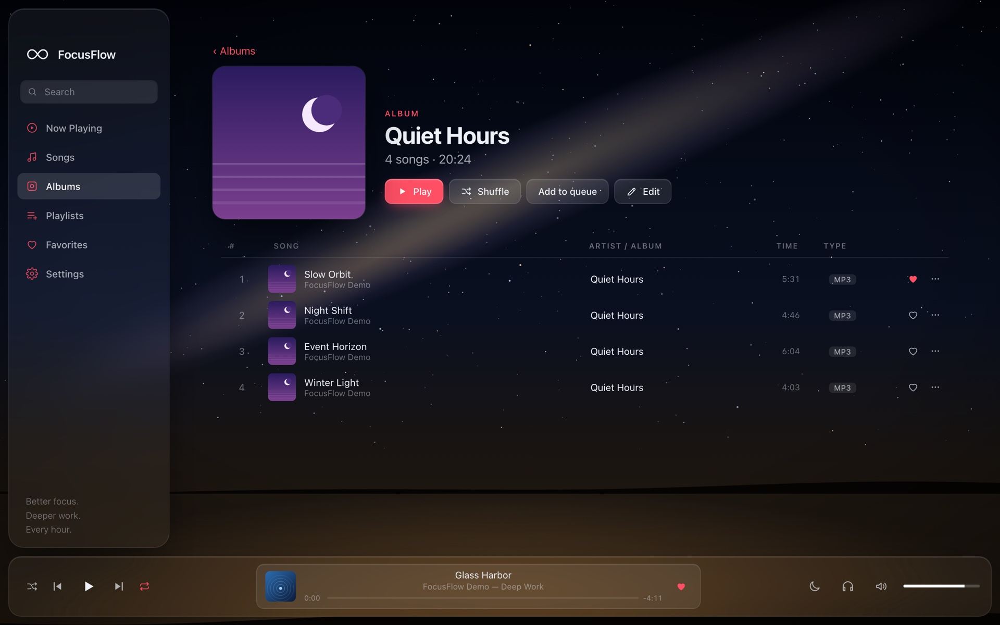<br/><sub><b>Album page</b>: Play, Shuffle, Edit</sub> | 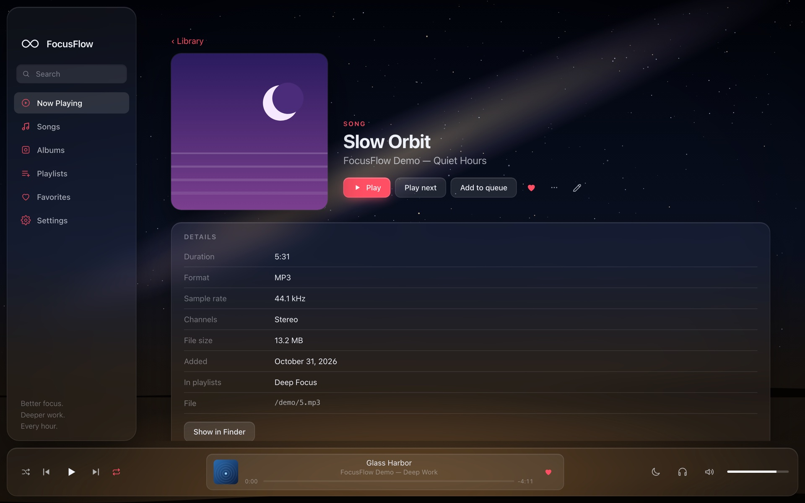<br/><sub><b>Song page</b>: details, editable title/artist/album</sub> |
| 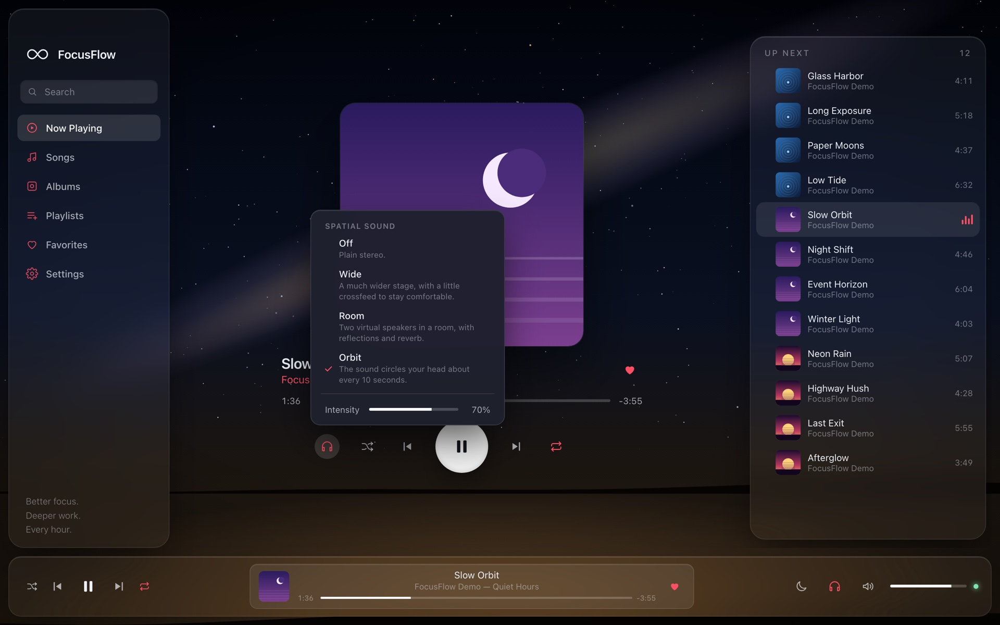<br/><sub><b>Spatial sound</b>: Off · Wide · Room · Orbit</sub> | 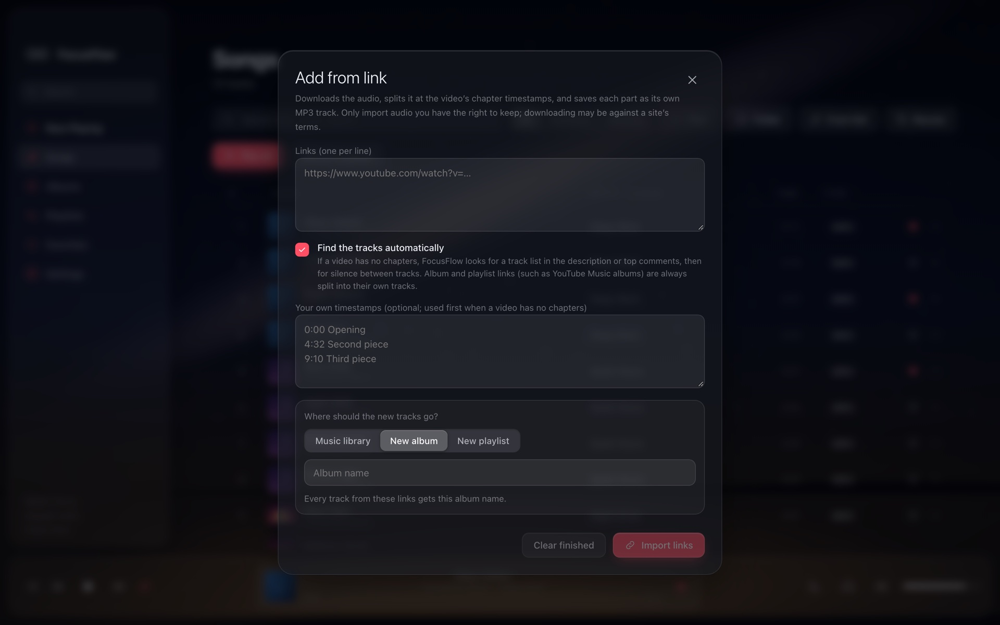<br/><sub><b>Add from link</b>: into your library, a new album, or a new playlist</sub> |
| 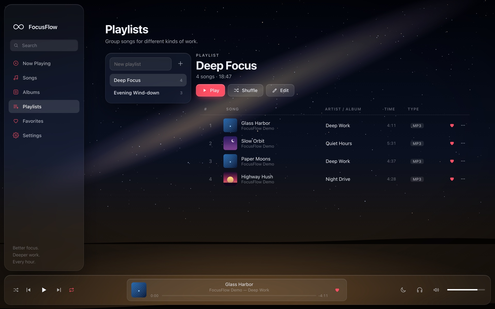<br/><sub><b>Playlists</b></sub> | 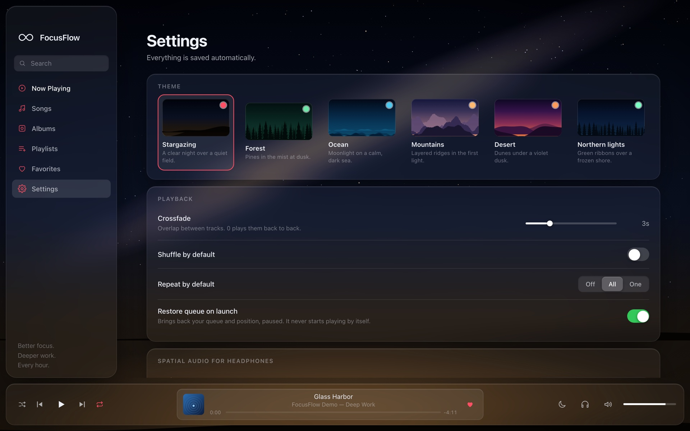<br/><sub><b>Settings</b>: themes, playback, power</sub> |

### Themes

Each theme is drawn from code (no photographs, nothing to license) and is completely static.

| Forest | Ocean | Mountains |
|:--:|:--:|:--:|
| 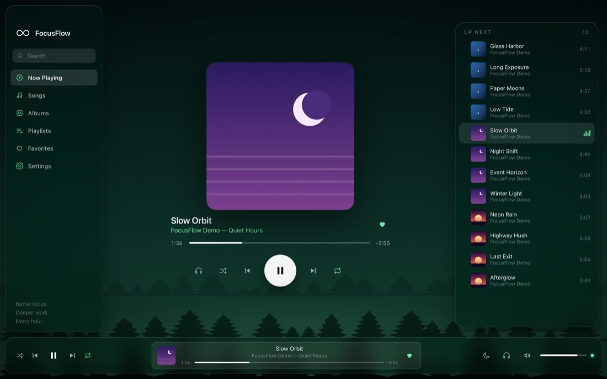 | 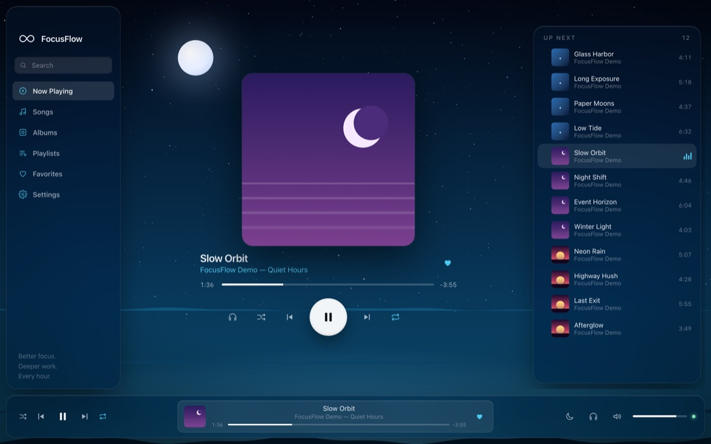 | 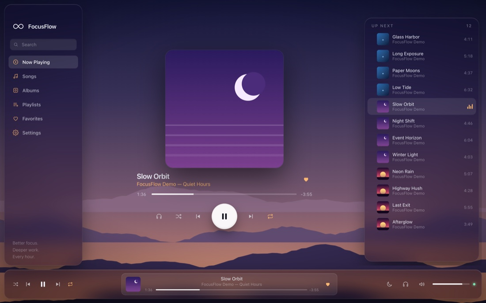 |
| **Desert** | **Northern lights** | **Stargazing** *(default)* |
| 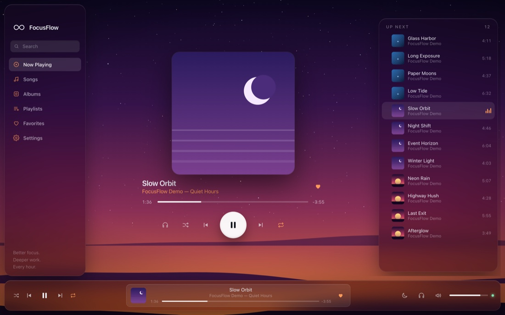 | 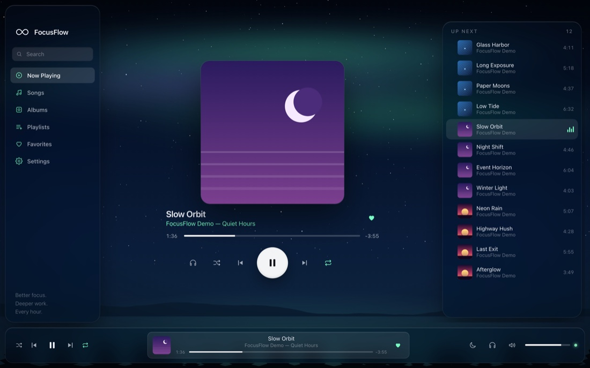 |  |

## Install

FocusFlow is built from source. You need macOS on Apple Silicon, [Node.js](https://nodejs.org), [Rust](https://rustup.rs) and the Xcode Command Line Tools (`xcode-select --install`).

```bash
git clone https://github.com/rudrat04/FocusFlow.git
cd FocusFlow
npm install
npm run tauri build
```

The build produces:

- `src-tauri/target/release/bundle/macos/FocusFlow.app`, which you can drag into `/Applications`
- `src-tauri/target/release/bundle/dmg/FocusFlow_0.1.0_aarch64.dmg`

The app is **unsigned**: the first time you open it, right-click → **Open**. (Distributing it to other people would need an Apple Developer ID and notarization.)

For development with hot reload: `npm run tauri dev`.

**Optional, for "Add from link" only:**

```bash
brew install yt-dlp ffmpeg
```

## Add your music

FocusFlow plays audio files you own or are licensed to use. Three ways to add them:

1. **Import files or a folder:** Songs → *Files* / *Folder*, or drag audio onto the window. Files are copied into your library folder (`~/Music/FocusFlow` by default, changeable) so moving the originals never breaks anything. Duplicates are detected by content; unreadable files are reported and skipped.
2. **Drop files into the library folder** and press **Rescan**.
3. **Add from link:** paste one or more links (see below).

### Add from link

Pick the destination first: your **Music library**, a **New album** (every track gets that name) or a **New playlist**. Then FocusFlow finds the tracks:

| Link type | What happens |
|---|---|
| **Video with chapters** | One track per chapter. |
| **Video without chapters** | Tried in order: your pasted timestamps → a timestamped track list in the **description** → a track list in the **top comments** → **silence between tracks**. Silence-detected tracks are named "Track 1, 2, …" (rename them on the song page). If nothing is found it stays one track. |
| **Album / playlist link** (e.g. `music.youtube.com/playlist?list=…`) | Every entry becomes its own track with its own title and thumbnail; the album takes the playlist's name. |

The video's thumbnail becomes the cover art. A single-video link that merely contains `&list=` imports only that video; paste the playlist link itself to get them all. A continuous, gapless mix with no written track list can't be split by silence; paste timestamps for those.

> Only import audio you have the right to keep. Downloading can violate a site's terms.

**Keeping link import healthy.** `yt-dlp` breaks whenever YouTube changes, so FocusFlow checks how old your copy is (its version *is* its release date) and, past about six weeks, shows a banner with an **Update yt-dlp** button (it runs `brew upgrade yt-dlp` only when you press it). Failures are explained in plain English (private / removed video, sign-in or bot check, rate limiting, out-of-date yt-dlp, network trouble), network hiccups are retried automatically, and a blocked or out-of-date failure is retried once through alternate YouTube clients. Those retries are untested against real YouTube.

## Features

### Playback

- Play, pause, previous (restarts the track after 3 s), next, seek, volume, mute.
- **Shuffle** (each lap reshuffles without repeating the last song first) and **repeat** off / all / one.
- **Queue**: play next, add to end, remove, move up/down, or drag by the handle.
- **Gapless or crossfaded** transitions; the next track is preloaded so there is no gap.
- Restores your queue and position on launch, **paused**, never playing by itself.
- **Even out loudness** (Settings, on by default): tracks are analysed once, in the background at the lowest priority, and a gain of up to −14 / +9 dB is applied (never enough to clip) so everything plays at about −16 LUFS. Toggling it glides, with no click.
- **Exact seeking**, even in variable-bit-rate MP3s, and a high-quality resampler for files whose sample rate differs from your output device.
- A track that fails is logged, you get a toast, and playback skips to the next playable one.

### Library

- Songs, Albums, Playlists and Favorites, with search and filters (all / favorites / missing).
- **Even loudness.** Every track is measured (EBU R128) in the background and brought to a similar volume, so a quiet piano piece doesn't follow a loud one. Toggle it in Settings.
- **Mini player** you can float over other windows, plus an optional song title in the menu bar.
- **Albums and playlists are editable**: rename, add songs (with a picker), remove songs, delete. Playlists can be reordered. Every album and playlist page has **Play** and **Shuffle**.
- **Song page**: cover, duration, format, sample rate, channels, size, date added, playlists, file path, source link, and editable title / artist / album.
- Clicking a song's **thumbnail** (or the cover/title in the bottom bar) plays it and opens Now Playing.
- Missing files are flagged instead of breaking anything.

### Spatial sound

Switch from the headphone icon beside Shuffle on Now Playing (or in the bottom bar, or Settings):

- **Off**: plain stereo.
- **Wide**: a much wider stage, opens up near-mono recordings, with a little crossfeed to stay comfortable.
- **Room**: two virtual speakers in a room, with reflections and reverb.
- **Orbit**: the sound circles your head about every 10 seconds.

This is FocusFlow's own lightweight processing (interaural delay and level, head-shadow filtering, reflections, reverb), not measured-HRTF binaural rendering. It works with any stereo headphones, wired or Bluetooth. It can't work on a **mono** output: a Bluetooth headset drops to mono "call mode" when something uses its microphone, and FocusFlow warns you when that happens. AirPods also have system Spatial Audio in Control Center, which apps can't switch on; keep this Off if you use it.

### Earbuds, Bluetooth and media keys

FocusFlow publishes what's playing to macOS (title, artist, cover, position) and handles play/pause, next, previous and scrubbing from AirPods and earbuds, Bluetooth headsets, keyboard media keys and Control Center. Play/pause is applied directly by the audio engine, so it works even when the window is hidden. If the headphones that were playing disconnect, FocusFlow **pauses** instead of blasting the speakers.

### Sleep timer and power

- **Sleep timer** (moon button, 15–90 min): the volume fades out gradually, then playback stops.
- **Keep Mac awake while playing** holds an IOKit assertion (`PreventUserIdleSystemSleep`) only while audio plays and releases it on pause, quit or when you turn it off. It does not keep the display awake.
- **Resumes after sleep.** If music was playing when the Mac went to sleep, it carries on when the Mac wakes (a setting; off keeps it paused). Output-device changes (AirPods connecting, a cable pulled) are picked up instantly from macOS notifications rather than polling.
- **Mini player** (the pip icon in the bottom bar, or the menu-bar icon → *Mini player*): artwork, title, seek, previous / play / next, favorite, and a pin to keep it above other windows. It's a separate small window that exists only while it's open, so it costs nothing when closed.
- **Menu-bar title** (Settings): shows the current song next to the menu-bar icon.
- Closing the window **hides it to the menu bar** and the music keeps playing; the menu-bar icon has Play/Pause, Previous, Next and Quit.

## Keyboard shortcuts

| Key | Action | Key | Action |
|---|---|---|---|
| `Space` | Play / pause | `M` | Mute |
| `←` / `→` | Seek −10 s / +10 s | `S` | Shuffle |
| `⌘←` / `⌘→` | Previous / next | `R` | Cycle repeat |
| `↑` / `↓` | Volume | `F` | Favorite current song |

## Efficiency

FocusFlow is deliberately quiet on your CPU and battery: no animations, static scenes, a decoder that works in short bursts, and progress updates only twice a second (every few seconds when the window is hidden). `scripts/bench.sh` measures it.

Measured on an M2 MacBook Air, plugged in, window in front:

| Scenario | CPU (% of one core) | RAM |
|---|---|---|
| Paused | under 1% | ~220 MB |
| Playing | **2–5%** (≈ 0.3–0.6% of the whole chip) | 250–290 MB |
| Playing, window hidden to menu bar | **~2%** | ~250 MB |
| *An earlier build with animations* | *12–64%* | *270–380 MB* |

Run-to-run noise is large, so treat these as ranges. **Real battery drain has not been measured yet** (the Mac was plugged in); the unplugged test is in [`MANUAL_TEST_CHECKLIST.md`](MANUAL_TEST_CHECKLIST.md).

## How it works

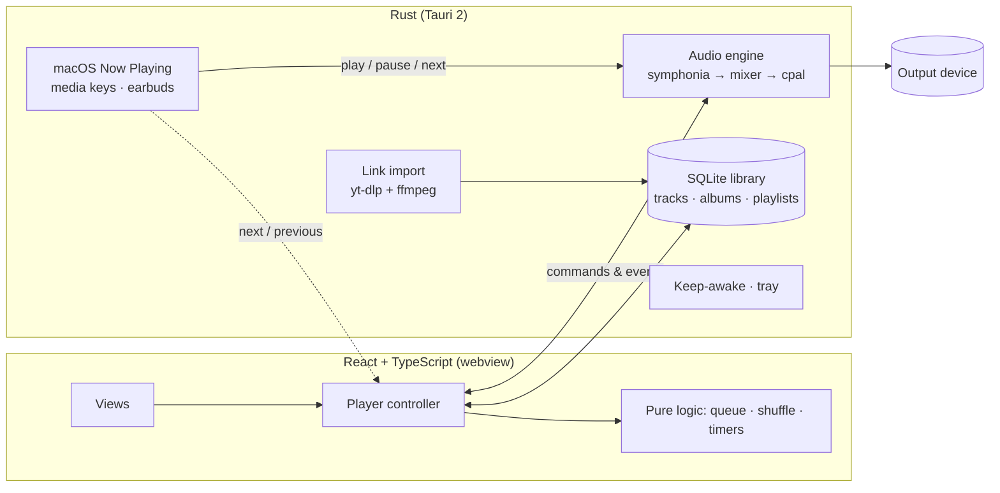

The Rust engine owns playback: it decodes on background threads into small ring buffers, mixes in the audio callback, starts crossfades, promotes the preloaded next track and follows output-device changes (re-opening the track if the sample rate changes). The UI sends commands and receives events.

```
src/                      React + TypeScript interface
  lib/queue.ts            queue, shuffle, repeat       (pure, tested)
  lib/timers.ts           sleep timer                  (pure, tested)
  lib/transition.ts       engine-event decisions       (pure, tested)
  lib/player.ts           controller: engine, library, persistence
  MiniApp.tsx             the floating mini player
  views/  components/     screens and UI parts
  themes.ts               generated landscapes
src-tauri/src/
  audio.rs                decoder threads, mixer, crossfade, device handling
  dsp.rs                  spatial sound modes
  library.rs              SQLite library, albums, playlists, artwork, import
  loudness.rs             EBU R128 loudness analysis and gain
  ytdl.rs                 link import, chapter / tracklist / silence splitting
  media.rs                macOS Now Playing and remote commands
  awake.rs                keep-awake power assertion
  lib.rs                  Tauri commands, menu-bar icon, window behaviour
scripts/                  selftest.sh · bench.sh · screenshots.sh
```

## Testing and honest status

```bash
npm test                          # 24 frontend tests: queue, shuffle/repeat, timers, transitions
cd src-tauri && cargo test --lib  # 51 backend tests: engine, resampler, seeking, loudness, library, sound modes, link import, keep-awake
./scripts/selftest.sh             # drives the built app end to end: 46 checks, plays quietly for ~1 minute
./scripts/bench.sh                # CPU / energy measurements
```

All of these pass. Three more engine tests run against real audio files and your real output device (`cargo test --lib -- --ignored`). The full breakdown, and exactly what was *not* verified, is in [`TEST_REPORT.md`](TEST_REPORT.md).

**Not verified yet** (it's a v0.1 personal project, so please be sceptical):

- Long runs: 30-minute, multi-hour and 24-hour playback, memory over time.
- macOS sleep/wake, device hot-swapping, and **real earbud / Bluetooth button presses**.
- Link import against real videos (the detection is tested on synthetic data and a local ffmpeg-built file).
- Real battery drain (unplugged).

Step-by-step manual tests for all of these are in [`MANUAL_TEST_CHECKLIST.md`](MANUAL_TEST_CHECKLIST.md).

## Known limitations

- **Some interruptions can't be prevented:** closing the lid on battery, a manual sleep, a flat battery, shutdown, and macOS updates. What FocusFlow *can* do, it does: it keeps the Mac from idle sleep while playing, resumes after wake, and follows device changes. Keep-awake only prevents *idle* sleep.
- **Loudness is measured once per track** (in the background, so a freshly imported track plays unadjusted until its measurement finishes, usually seconds). A very quiet track is boosted by at most 9 dB, and never past the point where it would clip.
- Release builds are **unsigned** (signing needs a paid Apple Developer account and matters only if you share the app).
- Link import depends on `yt-dlp` and the site, and can still break when the site changes; the updater and retries reduce this, they don't eliminate it.
- Spatial sound is FocusFlow's own lightweight processing, not measured-HRTF rendering.

## Troubleshooting

- **"Audio engine unavailable"**: no output device was found at launch. Choose one in System Settings → Sound and relaunch.
- **A song is skipped with an error toast**: Settings → Status shows the error log. Missing files are flagged in Songs; restore them and press **Rescan**.
- **Link import says tools are missing**: `brew install yt-dlp ffmpeg`. GUI apps don't see your shell's PATH, so FocusFlow looks in `/opt/homebrew/bin` and `/usr/local/bin`.
- **Earbud buttons still control something else**: start playback in FocusFlow once (it then becomes the active player), and check Control Center → Now Playing shows FocusFlow.
- **Spatial effects sound like nothing**: make sure the output is stereo (not a Bluetooth headset in call mode) and raise the intensity.
- **"Unidentified developer"**: right-click the app → Open, once.
- **Where is my data?** `~/Library/Application Support/com.focusflow.app/` (library database and small JSON settings files). Music lives in `~/Music/FocusFlow` unless you changed it.

## Contributing / regenerating screenshots

The screenshots come from the real interface running with demo data (`src/dev/mock.ts`). To regenerate them (needs Google Chrome):

```bash
./scripts/screenshots.sh
```

## Legal

FocusFlow contains no music and no third-party artwork; every cover and landscape is generated. It is a tool for playing audio you are entitled to use. The link-import feature drives the separately installed `yt-dlp` and `ffmpeg`; you are responsible for complying with the terms of any site you use it with and with copyright law. FocusFlow's own code is released under the [MIT License](LICENSE). Third-party libraries keep their own licenses.
